# claude-aitools

**AI Tools** is a mod for [Claude Code](https://claude.com/claude-code) that adds one slim ribbon above the prompt.
At a glance it shows how much of your Claude subscription you have used, how full the conversation is, and what the
work would have cost at API prices. Behind two small buttons it adds a live checklist of Claude's plan, a panel for
watching background tasks, a panel for cleaning up finished branches and worktrees, and a one-click handoff to a fresh session. In the desktop app, Clawd, Claude Code's mascot,
stands at the start of the bar acting out what Claude is doing.

It works in the **Code tab of the Claude desktop app** and in the **`claude` terminal app**.


## What it does

### Usage and cost at a glance

The bar reads left to right. Labels are dim, values brighter; usage and context turn **yellow at 70%** and **red at
90%**, so you notice before you hit a limit.

| You see | What it means |
|---|---|
| `5h 42%, 1h12m` | You have used 42% of your 5-hour allowance; it resets in 1 hour 12 minutes |
| `wk 74%, Thu` | You have used 74% of your weekly allowance; it resets Thursday |
| `ctx 31% 62k/200k` | How full this conversation's memory (context window) is |
| `tok 1.3M (+48k)` | Tokens this conversation has used this month, and in the last turn |
| `cache 42m` | How long Claude's prompt cache stays warm (a cold cache makes the next message cost more) |
| `cache 42m, $0.50` | After the cache time: what the next message would cost if the cache went cold, the whole context written to the cache again |
| `thread $3.12 (+$0.41)` | What this conversation, and its last turn, would cost at API prices |
| `~2.1% wk` | Roughly how much of your weekly allowance this conversation has taken |
| `month $184.20` | All your Claude Code use this month on this computer, at API prices |
| `limit ~3:40pm` | At your current pace, when you would run out of the 5-hour allowance |

Dollar figures are what the same work would cost through Anthropic's API, not what you pay for a subscription. They
are a handy way to see which conversations are expensive.

### Two buttons: tools and display options

**🛠** opens a row of tools above the bar. **⁝** opens the display options, where you can switch any part of the bar
on or off; the choices are saved. Anything switched off also stops doing work in the background. In the terminal the
two buttons read `tools` and `opts`.

When Claude's last answer asks you something in plain text instead of pop-up choices, a **?** button appears to the
left of **🛠**. Pressing it runs `/askme`.



### Project row

In a GitHub repository a second row shows the project you're working on: the repository's name and the issue the
session is about (from your first message, or the branch name), each opening in your browser; how many items are
open on its GitHub Project board (`3 project items`, opening the Project pane); how many branches it has besides main
(`5 branches`, opening the Branches pane); and how many background tasks are running (`2 bg tasks`).
On the right go the tools your project's own `.claude/aitools.json` defines: links, commands such as tests, and
servers with a status and a Start/Stop button. See [the project row](plugins/aitools/README.md#project-row) for the
file.

All of the bar's own settings live in `~/.claude/aitools.json`, which you can edit by hand.

### Task View and Clean View

Turn on **Task View** from the 🛠 row and, for any request that takes real work, Claude lays out its plan as a
checklist in the bar, between its top row and the project row, and ticks steps off as it goes, with a progress bar on
each. **▾** folds the list to its title and **▸** opens it again; **×** closes it until your next prompt. When it
finishes, the list folds to a single `✓ Done` line.

**Clean View** hides the stream of tool calls and work-in-progress text, leaving just Claude's final answer. The two
are separate toggles: turn on either, both or neither.



### Background tasks

For bigger jobs Claude hands pieces to subagents and workflows, and watches things with monitors. The project row
counts the ones running (`3 bg tasks`), and pressing it opens the **Background tasks** pane:
each task with its type, what it is doing, how far along a subagent is and how long it has run. Clawd gets a mini Clawd
stacked on his head for every task at work.



### Branches

Branches and worktrees from finished sessions pile up. The **Branches** pane lists every branch of the project, one
row each: whether it lives on your computer, on GitHub or both, whether it is checked out in a worktree, what it still
holds (changed files, unpushed or unmerged commits), how old it is, lines added and removed, its pull request, whether
CI passed, and a × to delete it. Filters show local or remote branches, and active or done ones.

A branch is **done** once its parent has all its work: its commits are on the base branch, or its pull request was
merged. **Clean up** removes every done branch's worktree, local branch and remote branch, after asking first.
Anything with work in it stays. Clawd prunes a tree beside the list, sweeps up while branches are removed, and naps
when there is nothing to clean up. The pane only reads git while it is open.



### Handoff

**Handoff** asks Claude for a short brief of the conversation: the goal, where things stand, decisions made, and the
next step. Copy it and paste it into a new session to pick up where you left off, with a fresh, empty context. Type
`/handoff` to get the same brief in the chat, copied to your clipboard.


### Commands

| Type | To |
|---|---|
| `/aitools` | Hide or show the whole bar (`/aitools on`, `/aitools off`), or the project row (`/aitools project off`) |
| `/handoff` | Write a handoff brief into the chat and copy it |
| `/keepwarm` | Keep the prompt cache warm while you're away: `/keepwarm` for 6 hours, `/keepwarm 90m`, `/keepwarm off`. A ☼ shows on the bar while it runs |
| `/askme` | Ask the questions from Claude's last answer again as pop-up choices, with a recommendation first |
| `/taskview`, `/cleanview` | Turn Task View or Clean View on or off |
| `/tasks` | Open or close the Background tasks pane |
| `/branches` | Open or close the Branches pane |

The full reference for every option is in the [mod's own README](plugins/aitools/README.md).

## Install

**From a terminal** (works for both the desktop app and the terminal app, since they share one setup). Open a
terminal (Terminal on macOS, PowerShell on Windows) and run these two commands:

```bash
claude plugin marketplace add pkkid/claude-aitools
claude plugin install aitools@claude-aitools
```

The first tells Claude Code where to find the mod; the second installs it. If the `claude` command is not found,
install Claude Code first by following [its setup guide](https://claude.com/claude-code).

**Or from inside a Claude Code terminal session**, type the same two steps at the prompt:

```
/plugin marketplace add pkkid/claude-aitools
/plugin install aitools@claude-aitools
```

**Then start a new session.** The bar appears above the prompt. In the desktop app the mod is listed under
**+ › Plugins › Manage plugins** next to the prompt box.

## Turn it off, update, or remove it

- **Hide the bar** for a while: type `/aitools off` (and `/aitools on` to bring it back). The choice is remembered.
- **Hide parts of it**: press **⁝** and switch off what you don't need.
- **Get the latest version**:

  ```bash
  claude plugin marketplace update claude-aitools
  claude plugin update aitools@claude-aitools
  ```

- **Remove it**:

  ```bash
  claude plugin uninstall aitools@claude-aitools
  ```

  In a terminal session you can also do all of this from the menu that `/plugin` opens, under **Installed**.

## Develop

Want to help build the mod or add a new one? See [DEVELOP.md](DEVELOP.md).
